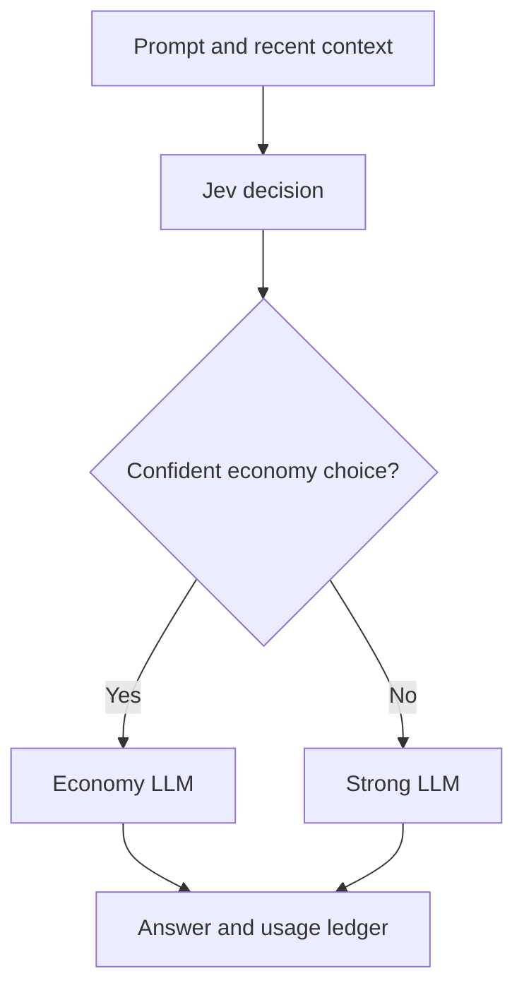

# Jev Smart Router Chatbot

A Streamlit chatbot that asks Jev to select an economical or stronger answer model.
The default integration uses TypeSafe for Jev and OpenRouter for both answer models.
You need two API keys with credits/access for Live mode. Demo works without keys.

## 1. Run in VS Code on Windows

Extract the ZIP. Open the `smart_router_chatbot` folder in VS Code, then open its terminal.
Use Python 3.11 or 3.12 for this project. Check available installations with `py -0p`.

```powershell
py -3.12 -m venv .venv
.\.venv\Scripts\python.exe -m pip install -r requirements.txt
.\.venv\Scripts\python.exe -m streamlit run app.py
```

If you have Python 3.11 instead, replace `-3.12` with `-3.11`.
No `Activate.ps1` command is needed, so PowerShell execution policy does not block these steps.
Visit http://localhost:8501 if the browser does not open automatically.

macOS/Linux:

```bash
python3 -m venv .venv
.venv/bin/python -m pip install -r requirements.txt
.venv/bin/python -m streamlit run app.py
```

## 2. Configure keys

1. Create a TypeSafe API key at https://console.typesafe.ai.
2. Create an OpenRouter API key at https://openrouter.ai/settings/keys.
3. Create your local secrets file from the template.

Windows PowerShell:

```powershell
Copy-Item .streamlit/secrets.toml.example .streamlit/secrets.toml
```

macOS/Linux:

```bash
cp .streamlit/secrets.toml.example .streamlit/secrets.toml
```

Skip the copy command if you already have a configured secrets.toml.

4. Open `.streamlit/secrets.toml` and enter your own keys:

```toml
TYPESAFE_API_KEY = "your-typesafe-key"
OPENROUTER_API_KEY = "your-openrouter-key"

LOW_MODEL = "openai/gpt-4.1-mini"
HIGH_MODEL = "openai/gpt-4.1"
```

5. Save the file and start the app. Select **Live → Auto** and submit a question.

For Streamlit Community Cloud, enter the same configuration in
**App settings → Secrets** instead of uploading your local secrets file.

Environment variables `TYPESAFE_API_KEY` and `OPENROUTER_API_KEY`
are also supported and take priority over saved secrets.

Never commit actual API keys to GitHub. Keep
`.streamlit/secrets.toml` in `.gitignore` and leave the example file's keys empty.

TypeSafe and OpenRouter require separate keys. Live usage requires
appropriate provider access and available credits.

## 3. Architecture and routing policy



The default threshold is 0.75; it is a starting policy, not a validated optimum.
Jev assesses task complexity in context. The low criterion covers simple questions,
rewriting and explanations. The high criterion covers difficult reasoning, debugging,
architecture and specialist tasks. `uncertain` or low-confidence economy decisions escalate.
Its confidence is a routing signal, not an answer-correctness probability.

Both Jev and the answering model see the same selected conversation messages. The
answering model also receives the assistant system instruction. By default, four previous
successful turns are kept, with an 18,000-character context cap; prompts over 12,000 characters
are rejected rather than silently cut. These are character safeguards, not tokenizer-exact limits.
Older whole turns are omitted when needed and the omission is shown in route details.

Manual Economy/Strong bypasses Jev. On a router error, Auto stops rather than silently
using another routing algorithm. No automatic retries are issued; if you resubmit after a
timeout, the earlier call may have been billed. A failed answer still leaves the router cost
in the ledger. Empty or malformed answer content is not added to chat history.

Demo uses a small keyword rule and a placeholder response, NOT Jev or an LLM.
Switching environment clears the conversation to avoid sending demo content to live models.
The live usage ledger remains until the Streamlit session ends. New conversation also preserves it.

## 4. Models and costs

Defaults checked against official provider pages on 15 October 2026:

| Role | Model | Input USD / million tokens | Output USD / million tokens |
|---|---|---:|---:|
| Router | jev-latest | 0.042 | 0 |
| Economy | openai/gpt-4.1-mini | 0.40 | 1.60 |
| Strong | openai/gpt-4.1 | 2.00 | 8.00 |

These are example tiers, not a claim that this is the best model pair for every workload.
Change IDs and prices in the sidebar when trying other OpenRouter chat models. Models must
accept chat completions and `max_tokens`. Keep the two tiers distinct to gain routing value.
An alias such as `jev-latest` can change; the returned model version is recorded.

Estimated cost = input_tokens × input_rate / 1,000,000 + output_tokens × output_rate / 1,000,000.
Auto totals include BOTH the decision call and the answer call. Prices are editable and
estimates do not reconcile billing discounts, caching, fees or taxes. Missing usage is unknown,
never silently counted as free. Provider dashboards remain authoritative for actual spend.

Example only: 1,000 Jev input tokens, 1,000 answer input tokens and 500 answer output tokens
cost about $0.001242 on the economy path. The same answer-token counts priced at strong rates
would cost $0.006 without routing. That difference is a same-token price illustration, NOT a
measured quality-equivalent saving. If Jev selects strong, routing adds overhead versus going
straight to strong. Savings depend on the proportion of easy prompts and acceptable answer quality.

No extra LLM classifier call, verifier call or automatic regeneration is hidden in this app.
Bounded context, an output cap and one selected answer model keep the flow economical.

## 5. Validate effectiveness before claiming savings

Run offline tests (no API keys or paid calls required):

```powershell
.\.venv\Scripts\python.exe -m unittest discover -s tests -v
```

`evaluation_prompts.json` contains a small starter set, not a benchmark result. Add real prompts
from your intended users, including short follow-ups and complex tasks with simple wording.
Use separate conversations to compare Auto and Strong. Record correctness against a rubric,
route choice, latency and real usage. Human-review the answers blind to the selected model.
Tune the threshold on a development split, then report cost and answer quality on held-out prompts.
Do not tune and report on the same examples. Include Jev overhead and failed requests in spend.

## 6. Files

- `app.py`: Streamlit UI, session history and usage exports.
- `core.py`: routing request, confidence policy, API clients and cost ledger.
- `tests/test_core.py`: mocked integration and failure-path tests.
- `evaluation_prompts.json`: starter cases for manual quality evaluation.
- `.streamlit/`: theme and example secrets.

## 7. Troubleshooting and scope

- 401: replace the key for the failing provider.
- 402 or quota error: check that provider's API credit balance.
- 403/404: verify model ID and account access.
- 429: wait and check request limits/credits.
- Timeout: check connectivity and provider dashboard before resubmitting.
- No readable answer: check model compatibility and increase the output cap if necessary.
- Lost context: increase previous turns or restate the relevant details.

This is a runnable local prototype. It has no browser/search, RAG, file upload or external
action tools. Strong routing does not give a model fresh information. It is not a trained
router or a proven quality guarantee. There is no persistent database; refreshing/disconnecting
may lose the session, so download the ledger if needed.

For hosting, keep secrets in the host's secret manager and run `streamlit run app.py`.
Do not expose an app funded by your keys publicly without authentication, per-user limits
and provider spending caps. Those production controls are not implemented in this local build.

## Sources

- https://docs.typesafe.ai/introduction
- https://docs.typesafe.ai/introduction/quickstart
- https://docs.typesafe.ai/primitives/choice
- https://docs.typesafe.ai/models
- https://openrouter.ai/docs/api/reference/overview
- https://openrouter.ai/openai/gpt-4.1-mini
- https://openrouter.ai/openai/gpt-4.1
- https://docs.streamlit.io/develop/api-reference/chat/st.chat_input

Live paid calls require your own credentials; offline tests cannot prove live API access or routing quality.
